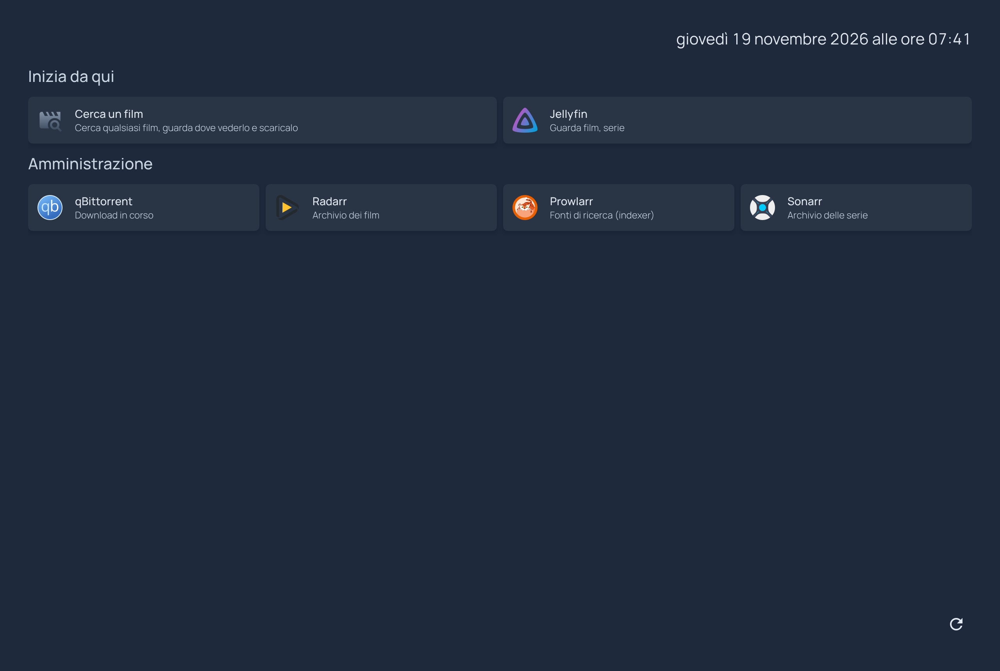
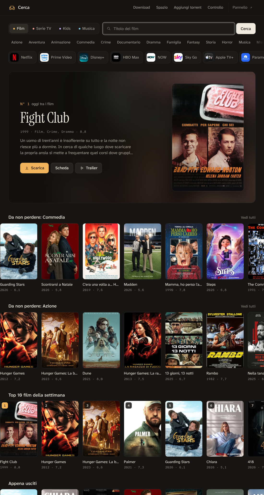
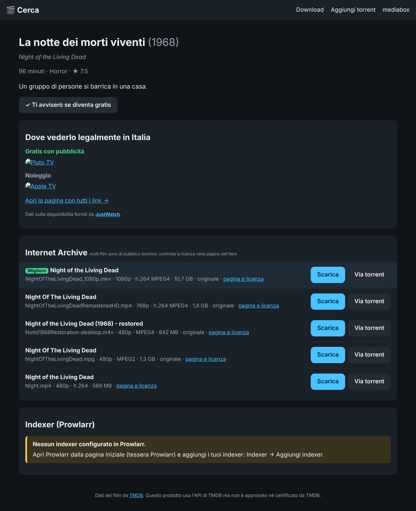
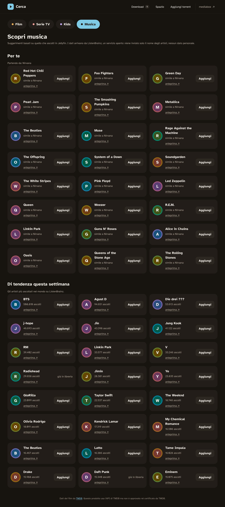
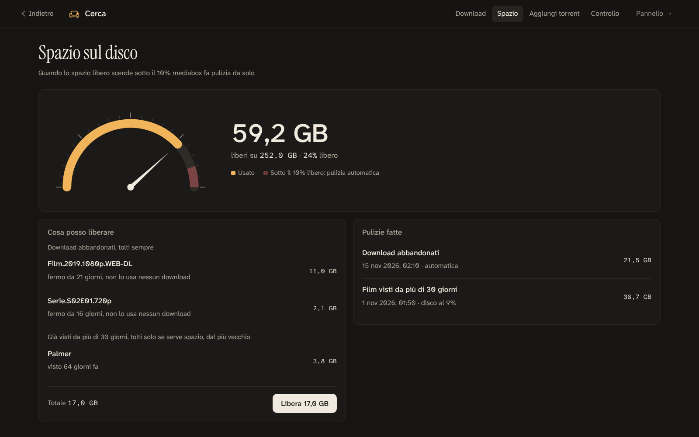
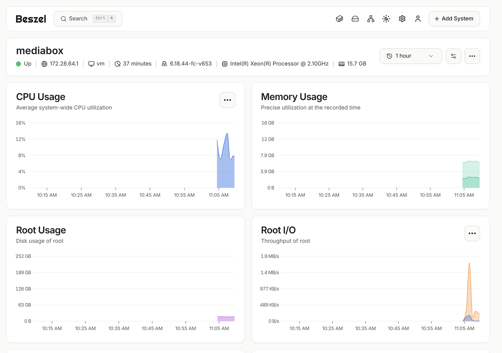

# mediabox

**mediabox** trasforma un PC in un media server per tutta la casa. Lo installi con un solo comando e poi apri un solo indirizzo nel browser: **http://mediabox.local**.

Con mediabox puoi:

- **guardare** film, serie, anime e TV in diretta, e **ascoltare musica**, sulla TV, sul telefono o sul PC, con locandine, stagioni, saghe e guida TV (Jellyfin);
- **cercare qualsiasi film** per titolo e vedere subito:
  - dove guardarlo legalmente in Italia (gratis, in abbonamento, a noleggio);
  - se esiste su Internet Archive, per scaricarlo direttamente;
  - cosa trovano i tuoi indexer di Prowlarr;
- **scaricare** un film e ritrovarlo in Jellyfin già rinominato e con la locandina, senza fare nient'altro;
- **aggiungere un torrent** trovato da te (magnet, link o file `.torrent`), con l'upload ridotto al minimo;
- **ricevere un avviso** quando un film della tua lista diventa gratis su un servizio con pubblicità;
- vedere **i film di tendenza e le nuove uscite** al cinema in Italia;
- avere i **sottotitoli in italiano** (e nelle lingue che scegli) scaricati in automatico;
- scoprire **musica nuova** simile a quella che ascolti, e le tendenze della settimana;
- tenere d'occhio **spazio, processore e temperatura**, con **pulizia automatica** quando il disco si riempie;
- ricevere da solo gli **aggiornamenti** di mediabox quando esce una nuova versione;
- usare tutto anche **da fuori casa**, senza aprire porte sul router (Tailscale).

---

## Indice

1. [Cosa serve](#cosa-serve)
2. [Installazione su Linux](#installazione-su-linux)
3. [Installazione su Windows](#installazione-su-windows)
4. [Primi passi](#primi-passi)
5. [Come si usa Cerca](#come-si-usa-cerca)
6. [Serie, anime e musica](#serie-anime-e-musica)
7. [Cambiare le scelte dopo l'installazione](#cambiare-le-scelte-dopo-linstallazione)
8. [Spazio, pulizia e monitoraggio](#spazio-pulizia-e-monitoraggio)
9. [Notifiche sul telefono](#notifiche-sul-telefono)
10. [Aggiornamenti](#aggiornamenti)
11. [TV in diretta](#tv-in-diretta)
12. [Usare mediabox fuori casa](#usare-mediabox-fuori-casa)
13. [Il comando mediabox](#il-comando-mediabox)
14. [Backup](#backup)
15. [Dove sono i file](#dove-sono-i-file)
16. [Risoluzione dei problemi](#risoluzione-dei-problemi)
17. [Per chi vuole mettere le mani nel codice](#per-chi-vuole-mettere-le-mani-nel-codice)

---

## Cosa serve

- Un PC sempre acceso, collegato alla rete di casa (meglio con il cavo).
  - **Linux** (consigliato): Debian 12 o Ubuntu Server 24.04, 64 bit. Un processore Intel con grafica integrata permette la transcodifica hardware, cioè meno fatica per il PC.
  - **Windows**: Windows 10 (versione 22H2) o Windows 11, 64 bit, con la virtualizzazione attiva nel BIOS. Ci sono alcuni limiti, elencati in [Differenze su Windows](#differenze-su-windows).
- Facoltativi:
  - l'app **ntfy** sul telefono, per le notifiche;
  - un **tuner TV**: HDHomeRun di rete oppure chiavetta USB DVB-T2.

**Non serve nessuna chiave né registrazione.** Senza chiavi Cerca usa fonti gratuite:

| Cosa | Da dove arriva |
|---|---|
| Ricerca e schede dei film, in italiano, con locandine e voti | Radarr (già installato) |
| Film di tendenza e appena usciti | la pagina *Scopri* di Radarr |
| Film per genere, cartoni per Kids, *Originali Netflix / Prime Video / Disney+* | [Wikidata](https://www.wikidata.org) |
| Serie: ricerca, serie del momento, serie per genere e per piattaforma | [TVmaze](https://www.tvmaze.com) (titoli e trame in inglese) |
| Dove vederlo in Italia | un link alla ricerca di [JustWatch](https://www.justwatch.com/it) |

**Chiave TMDB facoltativa.** Se la metti nelle impostazioni (`/impostazioni`, in fondo alla pagina), Cerca usa TMDB: ogni scheda mostra direttamente su quali servizi si guarda il film in Italia, le righe "Su Netflix" mostrano il catalogo italiano vero, le serie hanno titoli e trame in italiano e torna il pulsante "Avvisami se diventa gratis". La chiave è gratuita su [themoviedb.org](https://www.themoviedb.org/signup) → *Impostazioni → API*: vanno bene sia la **API Key** corta sia il **Read Access Token** lungo. Se la togli, Cerca torna alle fonti gratuite.

---

## Installazione su Linux

Accedi al PC con il tuo utente normale (non root) e scrivi:

```bash
git clone https://github.com/mariotomasini/Sofa.git mediabox
cd mediabox
./install.sh
```

L'installer non fa domande nel terminale (a parte la password del tuo utente, per `sudo`):

1. controlla il sistema e installa Docker se manca;
2. riconosce la scheda grafica Intel, i tuner USB e un eventuale HDHomeRun in rete;
3. ti scrive l'indirizzo da aprire nel browser, ad esempio **`http://mediabox.local`**. Va bene anche il telefono, se è sulla stessa rete;
4. nel browser una **procedura guidata** ti chiede, un passo alla volta:
   - la **password** di amministrazione;
   - **cosa guardi**: serie TV, anime, musica, sottotitoli, pulizia, aggiornamenti…;
   - **dove salvare** film e musica, con lo spazio libero di ogni disco e quello consigliato;
   - gli **avvisi sul telefono**, con un pulsante per mandare una notifica di prova;
5. premi **Installa** e segui l'avanzamento: i passi si spuntano uno alla volta e vedi quale programma sta scaricando;
6. alla fine la pagina mostra gli indirizzi, il server da scrivere nell'app Jellyfin della TV e le poche cose da fare a mano.


La prima volta ci vogliono **10-20 minuti**, a seconda della connessione.

Puoi rilanciare `./install.sh` quando vuoi: non cancella nulla e sistema quello che manca. Se è già configurato, la procedura nel browser non si riapre. mediabox viene installato in `/opt/mediabox`.

---

## Installazione su Windows

1. Scarica mediabox da GitHub (*Code → Download ZIP*) ed estrai la cartella.
2. Fai **doppio clic su `installa.cmd`** e accetta la richiesta di permessi.
3. Se WSL2 non è ancora attivo, l'installer lo attiva e chiede di **riavviare**. Dopo il riavvio e l'accesso, l'installazione riparte da sola.
4. Docker Desktop viene installato da solo. Al primo avvio potrebbe chiederti di accettare le condizioni d'uso: accettale (per uso personale è gratuito).
5. Si apre da solo il browser con la **procedura guidata**, la stessa di Linux. In più c'è il passo **Il PC**, con tre scelte consigliate: chiamare il PC **MEDIABOX** (per l'indirizzo `mediabox.local`, con un riavvio alla fine), impostare la rete di casa come *Privata* e togliere la sospensione quando è collegato alla corrente.

mediabox viene installato in `C:\Mediabox`. I film vanno nel disco con più spazio, ad esempio `D:\Mediabox`, e li vedi anche da Esplora file.

### Accensione automatica su Windows

Docker Desktop parte quando entri in Windows. Perché mediabox riparta da solo anche dopo un'interruzione di corrente, attiva l'**accesso automatico**:

1. premi `Win + R`, scrivi `netplwiz` e premi Invio;
2. togli la spunta *"Per utilizzare questo computer è necessario che l'utente immetta il nome utente e la password"* e conferma con la tua password.

Su Windows 11 l'opzione non compare se è attivo l'accesso senza password: vai in *Impostazioni → Account → Opzioni di accesso*, disattiva *"Per una maggiore sicurezza, consenti l'accesso a Windows Hello..."* e riprova.

Nel BIOS, se c'è, attiva anche *"Restore on AC power loss: Power On"*, così il PC si riaccende da solo.

### Differenze su Windows

| | Linux | Windows |
|---|---|---|
| Transcodifica con la grafica Intel | ✅ | ❌ usa il processore (limite di Docker Desktop) |
| Tuner USB + TVHeadend | ✅ | ❌ non supportato: usa un HDHomeRun di rete |
| `mediabox.local` | ✅ automatico | ✅ se il PC si chiama MEDIABOX |
| Si accende da solo | ✅ | ⚠️ serve l'accesso automatico |

Per guardare film sulla TV di casa la transcodifica di solito non serve, perché la TV riproduce il file così com'è. Serve soprattutto da fuori casa o con più TV contemporaneamente.

---

## Primi passi

Apri **http://mediabox.local** dal browser di un PC o di un telefono collegato alla rete di casa. Se non si apre, usa l'indirizzo IP mostrato nel riepilogo, ad esempio `http://192.168.1.50`.



| Pagina | Indirizzo | Password? |
|---|---|---|
| Pagina iniziale | `/` | no |
| Cerca un film | `/cerca` | no |
| Jellyfin | `/jellyfin` | utente e password di Jellyfin |
| qBittorrent | `/qbit` | sì (amministrazione) |
| Radarr | `/radarr` | sì |
| Prowlarr | `/prowlarr` | sì |
| Sonarr *(serie e anime)* | `/sonarr` | sì |
| Lidarr *(musica)* | `/lidarr` | sì |
| Bazarr *(sottotitoli)* | `/bazarr` | sì |
| Beszel *(grafici del PC)* | `/beszel` | il suo accesso: admin@mediabox.local |
| TVHeadend *(se c'è un tuner USB)* | `/tv` | sì |

L'utente è sempre **admin** e la password è quella che hai scelto durante l'installazione.

### 1. Aggiungi i tuoi indexer (una volta sola)

Apri **Prowlarr** dalla pagina iniziale, vai su *Indexer → Aggiungi indexer* e aggiungi quelli che usi. Prowlarr li passa da solo a Radarr e a Cerca. Senza indexer, Cerca mostra comunque la disponibilità legale e Internet Archive.

### 2. Collega la TV

Installa l'app **Jellyfin** sulla TV (Android TV, Fire TV, LG, Samsung...). Come server scrivi:

```
http://mediabox.local/jellyfin
```

Se la TV non lo trova, usa l'IP: `http://192.168.1.50/jellyfin`. Molte TV non riconoscono i nomi `.local`.

---

## Come si usa Cerca

In alto scegli il **mondo**: **Film**, **Serie TV**, **Kids** o **Musica**. Ogni mondo ha il suo colore, la sua ricerca e le sue novità:

- **Film** e **Serie TV**: una pagina come quella di Netflix (vedi sotto). Nelle Serie TV c'è anche la riga dei nuovi episodi delle serie che segui in Sonarr; scegliendo una serie si apre Sonarr, dove decidi cosa scaricare;
- **Kids**: solo cartoni e film per famiglie, con locandine più grandi e generi adatti ai bambini. In Kids non si scarica nulla e il menu sparisce: si esce solo con **"Esci da Kids"** in alto a destra. Il PC o la TV restano in Kids finché non premi quel pulsante;
- **Musica**: suggerimenti di artisti e tendenze.

Sul telefono il menu è in basso: Home, Download, Spazio e Altro (Aggiungi torrent, Kids, mediabox). Con il telecomando della TV ti sposti con le frecce: l'elemento scelto ha un bordo bianco ben visibile.



### La pagina iniziale, come Netflix

Sotto la ricerca c'è la **fila dei generi** (Azione, Commedia, Horror…): toccane uno per vedere i titoli più visti di quel genere.

Poi, riga per riga:

1. **Perché ti piace: …** — due righe di consigli scelti in base ai generi di quello che hai visto (o messo tra i preferiti) in Jellyfin. I titoli che hai già non te li ripropone. Finché non hai visto nulla trovi "Da non perdere: Commedia / Azione" (per le serie: Dramma / Crime);
2. **Top 10 della settimana**, con i numeri grandi;
3. **Appena usciti**: i 10 titoli più visti usciti negli ultimi due mesi (film nei cinema italiani, serie nuove);
4. **Su Netflix, Su Prime Video, Su Disney+…**: una riga per ogni piattaforma che hai, con i titoli più visti in Italia inclusi nell'abbonamento (o gratis). Le scegli con il pulsante **Scegli le tue piattaforme** in fondo alla home, fino a 6: Netflix, Prime Video, Disney+, NOW, Apple TV+, Crunchyroll, RaiPlay e le altre disponibili in Italia. *Vedi tutti* apre la pagina della piattaforma. Sono titoli da guardare nell'app della piattaforma: mediabox non li scarica. Senza chiave TMDB le righe dei film diventano *Originali Netflix*, *Originali Prime Video*… (i film prodotti o distribuiti dalla piattaforma negli ultimi 3 anni) e quelle delle serie mostrano le serie con episodi usciti in questi giorni;
5. **Continua a guardare**: quello che hai lasciato a metà in Jellyfin, con la barra di quanto hai visto (per le serie anche il prossimo episodio). Toccalo e riparte in Jellyfin.

I consigli e "Continua a guardare" usano l'utente amministratore di Jellyfin creato all'installazione: se in famiglia usate utenti diversi, i consigli seguono quello.



1. Scrivi il titolo e premi **Cerca**.
2. Scegli il film giusto dalle locandine.
3. Nella scheda del film compaiono tre sezioni, che si caricano insieme:
   - **Dove vederlo legalmente in Italia**: servizi gratis con pubblicità, abbonamenti, noleggio e acquisto. I dati vengono da JustWatch.
   - **Internet Archive**: le versioni trovate, con la **migliore** in cima. Viene scelta la risoluzione più alta e il file originale invece delle copie compresse. **Scarica** salva il file direttamente; **Via torrent** usa il torrent ufficiale di Archive. Molti film su Archive sono di pubblico dominio: controlla sempre la licenza nella pagina dell'item.
   - **Indexer (Prowlarr)**: i risultati dei tuoi indexer, con dimensione, seed e peer. **Scarica** manda il torrent a qBittorrent.
4. Segui l'avanzamento nella pagina **Download**. A download finito mediabox passa il film a Radarr, che lo rinomina e lo mette nella libreria **Film** di Jellyfin con la locandina. Lo stato diventa **"Pronto in Jellyfin"**.

### Cerca come app sul telefono

Puoi mettere Cerca nella schermata Home del telefono: si apre a tutto schermo, con la sua icona, come un'app.

- **iPhone (Safari)**: apri `http://mediabox.local/cerca`, premi **Condividi** (il quadrato con la freccia) e poi **Aggiungi alla schermata Home**.
- **Android (Chrome)**: apri lo stesso indirizzo, premi **⋮** e poi **Aggiungi a schermata Home** (oppure **Installa app**).

Se `mediabox.local` sul telefono non funziona, usa l'indirizzo IP (es. `http://192.168.1.50/cerca`), oppure quello di Tailscale per usarla anche fuori casa.

Su Android, con un indirizzo `http://` la scorciatoia si apre nel browser. Si apre a tutto schermo solo con un indirizzo `https://`, per esempio quello HTTPS di Tailscale. Su iPhone si apre a tutto schermo in entrambi i casi.

### Avvisami se diventa gratis

Serve la chiave TMDB facoltativa: senza, il pulsante non compare.

Nella scheda di un film premi **"Avvisami se diventa disponibile gratis"**. Ogni giorno mediabox controlla se il film è comparso tra i servizi gratuiti con pubblicità, come Pluto TV o Rakuten TV:

- appena succede, lo trovi in evidenza nella pagina di Cerca;
- se hai configurato ntfy, ricevi anche una notifica sul telefono.

Per le notifiche installa l'app **ntfy** e iscriviti all'argomento che hai scelto durante l'installazione. Se l'hai saltato, scrivilo in `NTFY_TOPIC` nel file `.env` e poi esegui `mediabox configura`.

### Aggiungere un torrent trovato da te

Pagina **Aggiungi torrent**:

1. incolla un link magnet o l'indirizzo di un file `.torrent`, oppure carica il file;
2. facoltativo, cerca il film a cui si riferisce: a fine download verrà rinominato e messo in Jellyfin;
3. se non lo indichi, mediabox prova a capirlo dal nome. Se non ci riesce, nella pagina Download compare **"Scegli il film"**.

Puoi anche aggiungere i torrent direttamente da **qBittorrent** con la categoria `manuale`: mediabox li trova da solo e li gestisce allo stesso modo.

Per proteggerti da torrent falsi, qBittorrent **non scarica mai programmi** (`.exe`, `.bat`, `.scr`...).

### Upload ridotto al minimo

qBittorrent è impostato in modo fisso così:

- upload limitato a **1 KiB/s**;
- rapporto massimo **0**: appena finito il download, il torrent si **ferma**;
- **UPnP e NAT-PMP spenti**: nessuna porta viene aperta sul router.

---

## Serie, anime e musica

### Serie TV

Attivale dalle **impostazioni** (`/impostazioni`, voce *Serie TV*): viene installato **Sonarr**.

- In Sonarr cerchi una serie e la aggiungi. Sonarr scarica gli episodi (anche quelli nuovi, appena escono) e li ordina in `Serie/Nome serie (Anno)/Stagione 01/`.
- In Jellyfin ogni serie è **una sola scheda**, divisa in **stagioni** ed **episodi**.
- Jellyfin ricorda per ogni utente **gli episodi già visti** e **dove ti sei fermato**: in home trovi "Continua a guardare" e "Prossimi episodi". Se in casa siete in più, crea un utente per ciascuno (*Pannello di controllo → Utenti*).
- Il plugin Intro Skipper aggiunge i pulsanti **"Salta intro"** e **"Salta titoli di coda"**.

Cerca per ora è pensato solo per i film: le serie aggiungile da Sonarr.

### Anime

Attivali dalle **impostazioni** (voce *Anime*). In Jellyfin compare la libreria **Anime**, separata dalle serie, e Sonarr ottiene la cartella `anime`. Quando aggiungi un anime in Sonarr:

1. come *Cartella principale* scegli **/data/media/anime**;
2. come *Tipo di serie* scegli **Anime**: così Sonarr usa anche la numerazione assoluta degli episodi (es. "One Piece 1071"), che è quella usata da molti rilasci.

Per i sottotitoli degli anime aggiungi l'inglese e, se vuoi, il giapponese alle lingue (voce 6 del menu). Prowlarr passa a Sonarr anche le categorie anime degli indexer.

### Musica

La libreria **Musica** di Jellyfin c'è sempre: copia i tuoi album in `media/musica`, meglio se ordinati come `Artista/Album/01 - Brano.mp3`. Jellyfin scarica copertine e informazioni da MusicBrainz.

Per scaricare e ordinare musica in automatico attiva **Lidarr** (voce 3): cerchi un artista, scegli gli album e Lidarr li mette in `Artista/Album (Anno)/`.

Per ascoltare dal telefono, anche offline e fuori casa, le app **Finamp** (gratuita) e **Symfonium** funzionano meglio dell'app Jellyfin. Symfonium (Android, circa 5 €) crea anche mix e playlist automatiche dai tuoi ascolti, come Spotify.

### Scoprire musica nuova

Nella pagina **Musica** di Cerca trovi:

- **Per te**: artisti simili a quelli che ascolti di più in Jellyfin. Più un artista è simile a vari tuoi preferiti, più sale in classifica; quelli che hai già non compaiono.
- **Di tendenza questa settimana**: gli artisti più ascoltati nel mondo.
- con Lidarr attivo, il pulsante **Aggiungi**: Lidarr scarica l'ultimo album dell'artista, e il resto lo scegli tu in Lidarr.



I suggerimenti arrivano da [ListenBrainz](https://listenbrainz.org), un servizio aperto e gratuito: non serve un account e viene inviato solo il nome degli artisti, non cosa ascolti né quando.

### Sottotitoli

**Bazarr** è attivo di serie: cerca da solo i sottotitoli dei film e delle serie, nelle lingue scelte (all'inizio italiano e inglese). Li salva accanto al video e Jellyfin li mostra subito.

Per trovarne di più in italiano crea un account gratuito su [opensubtitles.com](https://www.opensubtitles.com) e aggiungilo in *Bazarr → Impostazioni → Fornitori*.

### Saghe

I film della stessa saga (es. tutti i "Rocky" o tutti gli "Harry Potter") vengono raggruppati da soli in Jellyfin, nella sezione **Collezioni** della libreria Film.

### Indexer protetti da Cloudflare

Alcuni siti mostrano un controllo "Sei un robot?" che blocca Prowlarr. mediabox installa **FlareSolverr**, che lo supera. Per usarlo, in Prowlarr apri l'indexer e aggiungi l'etichetta **flaresolverr**.

---

### PC con poca memoria

Se il PC ha meno di 6 GB di memoria, l'installer spegne da solo i programmi più pesanti: *Aiuto per i siti protetti* (FlareSolverr), *Musica da scaricare* (Lidarr), *Sottotitoli automatici* (Bazarr) e *Grafici del PC* (Beszel). Lo fa una volta sola e lo scrive nella finestra. Nella configurazione e nelle impostazioni quei programmi mostrano quanta memoria usano: puoi riaccenderli, ma il PC potrebbe rallentare molto e alcuni programmi potrebbero non partire. Su un PC così mediabox serve bene per cercare, scaricare e guardare film in casa; la conversione dei video al volo invece non è possibile.

## Cambiare le scelte dopo l'installazione

Apri **`http://mediabox.local/impostazioni`**: la trovi anche nella pagina iniziale, tessera *Impostazioni*. Accedi con la password di amministrazione e trovi le stesse scelte della procedura guidata, tutte in una pagina: chiave TMDB, cosa guardi, lingue dei sottotitoli, cartella dei media e avvisi sul telefono. Premi **Salva e applica**: mediabox installa, configura o spegne quello che serve, e la pagina mostra l'avanzamento. Se cambi cartella, i film già scaricati vengono spostati da soli.

Le modifiche le applica un servizio di sistema (su Linux `mediabox-impostazioni.path`, su Windows l'attività pianificata *mediabox - impostazioni dal browser*). Su un sistema senza systemd scrivi `mediabox applica-impostazioni` dopo aver salvato.

Se preferisci il terminale, c'è ancora il menu di una volta:

```bash
mediabox impostazioni
```

```
   [✔] 1. Serie TV (Sonarr le scarica e le ordina per stagioni)
   [ ] 2. Anime (libreria separata in Jellyfin, gestiti da Sonarr)
   [ ] 3. Musica con Lidarr (scarica e ordina per artista e album)
   [✔] 4. Sottotitoli automatici (Bazarr)
   [✔] 5. FlareSolverr (aiuta gli indexer protetti da Cloudflare)
   [ ] 6. Pulizia automatica dei film ed episodi già visti quando il disco è quasi pieno
   [ ] 7. Beszel (grafici di processore, memoria, dischi e temperatura, con avvisi)
   [✔] 8. Aggiornamenti automatici di mediabox quando esce una nuova versione

       l. Lingue dei sottotitoli: it,en
       n. Notifiche sul telefono (ntfy): non impostate
       c. Cartella di film, musica e download: /srv/mediabox/dati
```

Scrivi il numero di una voce per attivarla o disattivarla, oppure una lettera per cambiare lingue, notifiche o cartella. Poi scrivi `s` per salvare: mediabox installa, configura o spegne quello che serve.

Se disattivi un servizio, le sue impostazioni restano salvate: riattivandolo ritrovi tutto com'era. I file scaricati non vengono mai cancellati.

---

## Spazio, pulizia e monitoraggio

### Nella pagina iniziale

In alto trovi sempre processore, memoria, temperatura e **spazio libero sul disco dei film**.


### Avviso e pulizia automatica

Quando lo spazio libero scende sotto il **10%** (si cambia con `SOGLIA_DISCO_LIBERO` nel file `.env`), mediabox fa pulizia da solo:

1. **sempre**: toglie i **download abbandonati**, cioè download falliti o annullati che nessuno usa più da almeno 14 giorni;
2. **solo se la attivi** (impostazioni, voce *Pulizia quando il disco è pieno*): toglie anche **film ed episodi già visti da più di 30 giorni**, partendo dai più vecchi, finché lo spazio torna sufficiente.

La pulizia non tocca mai:

- i **preferiti** (❤️ in Jellyfin);
- quello che qualcuno sta ancora guardando;
- la musica e le registrazioni;
- i film che hai copiato tu a mano.

I film e gli episodi tolti non vengono riscaricati: Radarr e Sonarr smettono di seguirli. Se ne vuoi uno indietro, riaggiungilo da Cerca.

Se dopo la pulizia lo spazio è ancora poco, ricevi un avviso sul telefono (ntfy) e in Cerca compare un riquadro rosso.

Nella pagina **Spazio** di Cerca vedi cosa si potrebbe liberare, puoi lanciare la pulizia a mano con **"Libera spazio adesso"** e trovi l'elenco di tutto quello che è stato tolto.



### Beszel: grafici e avvisi del PC

Attivalo dalle impostazioni (voce *Grafici del PC*). All'indirizzo `/beszel` trovi i grafici di processore, memoria, dischi, rete e temperatura delle ultime ore e degli ultimi giorni.

Ricevi un avviso sul telefono, se hai impostato ntfy, quando:

- il PC non risponde;
- il processore o la memoria restano oltre il 90% per 10 minuti;
- il disco supera il 90%;
- la temperatura supera 85 °C.

Per entrare in Beszel usa l'email **admin@mediabox.local** e la password di mediabox. Beszel ha il suo accesso e non usa la password dei pannelli.



Su Windows Beszel misura la macchina virtuale di Docker e non tutto il PC: i valori di disco e temperatura possono essere diversi da quelli di Windows.

---

## Notifiche sul telefono

mediabox può mandarti notifiche con l'app gratuita **ntfy**, senza account:

1. scegli un **argomento**, cioè un nome difficile da indovinare, es. `mediabox-rossi-4821`. La procedura guidata te ne propone uno, e lo cambi quando vuoi dalle impostazioni (*Avvisi sul telefono*);
2. sul telefono installa **ntfy** (Play Store, F-Droid o App Store), premi **+** e scrivi lo stesso argomento.

Riceverai un avviso quando:

- un film scaricato è **pronto in Jellyfin**;
- un film della lista "avvisami" diventa **gratis**;
- il disco è **quasi pieno**, o mediabox ha fatto pulizia;
- mediabox si è **aggiornato**, o l'aggiornamento non è riuscito;
- con Beszel attivo, il PC non risponde, è sotto sforzo o troppo caldo.

L'argomento è come una password: chi lo conosce vede le tue notifiche. Non sceglierne uno ovvio.

---

## Aggiornamenti

Ogni notte, verso le 4:30, mediabox controlla se su GitHub è uscita una **nuova versione**. Se c'è:

1. fa un backup;
2. scarica la nuova versione;
3. aggiorna i servizi e riapplica la configurazione;
4. ti avvisa sul telefono (ntfy) quando ha finito, o se qualcosa non è andato.

Il file `.env` e le tue scelte restano come sono. Le versioni dei servizi che hai cambiato a mano nel `.env` non vengono toccate.

- Per aggiornare subito: `mediabox update`.
- Per vedere la versione installata e l'ultima disponibile: `mediabox versione`.
- Per spegnere gli aggiornamenti automatici: impostazioni, voce *Aggiornamenti automatici*.

Su Linux l'aggiornamento automatico lo fa un timer di systemd (`mediabox-aggiorna.timer`), su Windows un'attività pianificata ("mediabox - aggiornamento automatico").

> Per chi pubblica mediabox: una nuova versione è una **Release** su GitHub con un tag come `v1.3.0`. Ricordati di aggiornare il file `VERSION` con lo stesso numero.

---

## TV in diretta

L'installer cerca da solo un tuner:

- **HDHomeRun** in rete → viene collegato a Jellyfin automaticamente;
- **chiavetta USB DVB-T2** (solo Linux) → viene avviato **TVHeadend** e collegato a Jellyfin, guida TV compresa;
- **nessun tuner** → la TV in diretta viene saltata, e il riepilogo lo dice.

Se colleghi un tuner dopo l'installazione, rilancia `./install.sh` (o `installa.cmd`).

Per **registrare** una serie: in Jellyfin apri la *Guida*, scegli un programma e premi *Registra serie*. Le registrazioni finiscono nella libreria **Registrazioni**.

### Tuner USB: cosa resta da fare a mano

L'installer crea la rete DVB-T con l'elenco dei multiplex italiani, collega il tuner e fa partire la ricerca dei canali. Dopo **5-10 minuti**:

1. apri `http://mediabox.local/tv`;
2. vai su *Configurazione → DVB Inputs → Muxes* e controlla che diversi multiplex siano *OK*;
3. vai su *Configurazione → DVB Inputs → Servizi*, premi **"Mappa tutti i servizi"** e conferma;
4. in Jellyfin vai su *Pannello di controllo → TV in diretta* e premi **"Aggiorna dati guida"**.

Se trova pochi canali, controlla l'antenna e poi vai su *Configurazione → DVB Inputs → Reti*, seleziona "DVB-T Italia" e premi **"Forza scansione"**. Poi ripeti dal punto 3.

### HDHomeRun: la guida TV

Jellyfin non legge la guida TV dall'antenna. Per averla, metti in `EPG_XMLTV_URL` nel file `.env` l'indirizzo di una guida in formato XMLTV per l'Italia: ne esistono di gratuite, cerca "XMLTV Italia". Poi esegui `mediabox configura`.

---

## Usare mediabox fuori casa

Sul PC di mediabox scrivi:

```bash
mediabox remote
```

Il comando installa **Tailscale**, una rete privata gratuita, e ti chiede di accedere con un account. Poi:

1. installa l'app **Tailscale** sul telefono o sul portatile e accedi con lo stesso account;
2. apri l'indirizzo `http://100.x.x.x` che il comando ti ha mostrato. Nell'app Jellyfin usa `http://100.x.x.x/jellyfin`.

Non serve aprire nessuna porta sul router. mediabox risponde solo alla rete di casa e a Tailscale: rifiuta qualsiasi altro accesso.

---

## Il comando mediabox

Su Linux scrivilo in un terminale; su Windows in PowerShell o nel Prompt dei comandi.

| Comando | Cosa fa |
|---|---|
| `mediabox status` | mostra quali servizi sono accesi |
| `mediabox up` / `mediabox down` | accende / spegne tutto |
| `mediabox restart [servizio]` | riavvia tutto o un servizio (es. `mediabox restart jellyfin`) |
| `mediabox logs [servizio]` | mostra i messaggi di un servizio (Ctrl+C per uscire) |
| `mediabox impostazioni` | cambia cosa usi dal terminale (più comodo dal browser: `/impostazioni`) |
| `mediabox azzera-jellyfin` | rifà Jellyfin da zero con l'utente di mediabox (i film restano) |
| `mediabox configura` | riapplica la configurazione dopo una modifica al file `.env` |
| `mediabox update` | aggiorna mediabox e i servizi (fa prima un backup) |
| `mediabox versione` | mostra la versione installata e l'ultima disponibile |
| `mediabox backup` | crea un backup |
| `mediabox restore <file>` | ripristina un backup |
| `mediabox remote` | attiva l'accesso da fuori casa (Tailscale) |
| `mediabox indirizzi` | mostra gli indirizzi da aprire nel browser |

---

## Backup

```bash
mediabox backup
```

Il comando crea un file in `/opt/mediabox/backup/` (Windows: `C:\Mediabox\backup\`) con:

- le impostazioni di mediabox (`.env`, che contiene anche la password);
- la configurazione di tutti i servizi;
- la cronologia di Cerca.

**I film non sono inclusi**, perché sono troppo grandi: per quelli usa un disco esterno.

Copia il backup su una chiavetta. Per ripristinarlo, anche su un PC nuovo dopo aver installato mediabox:

```bash
mediabox restore /percorso/mediabox-backup-AAAA-MM-GG_HHMM.tar.gz
```

---

## Dove sono i file

| Cosa | Linux | Windows |
|---|---|---|
| Film | `/srv/mediabox/dati/media/film` | `D:\Mediabox\media\film` |
| Serie | `.../media/serie` | `...\media\serie` |
| Anime | `.../media/anime` | `...\media\anime` |
| Musica | `.../media/musica` | `...\media\musica` |
| Registrazioni TV | `.../media/registrazioni` | `...\media\registrazioni` |
| Download in corso | `.../downloads` | `...\downloads` |
| Impostazioni (`.env`) | `/opt/mediabox/.env` | `C:\Mediabox\.env` |

I film vengono rinominati come `Titolo (Anno) [tmdbid-123]/Titolo (Anno) Qualità.mkv`, così Jellyfin li riconosce sempre.

Puoi anche copiare tu dei film nella cartella `film`: per farli riconoscere a colpo sicuro, mettili in una cartella chiamata `Titolo (Anno)`.

---

## Risoluzione dei problemi

Primo passo, sempre: `mediabox status`. Se un servizio è spento, usa `mediabox restart <servizio>`. Se continua a spegnersi, guarda `mediabox logs <servizio>`.

### `mediabox.local` non si apre

- **Usa l'indirizzo IP**: lo trovi con `mediabox indirizzi`. Funziona sempre.
- **Android e molte smart TV non riconoscono i nomi `.local`**: lì usa l'IP.
- Su **Linux**: controlla con `systemctl status mediabox-avahi` che il servizio sia attivo, e che il dispositivo sia nella stessa rete (non nella rete "ospiti" del router).
- Su **Windows**: il PC deve chiamarsi MEDIABOX e la rete deve essere impostata come **Privata**: *Impostazioni → Rete e Internet → la tua rete → Tipo di profilo di rete: Privata*.
- Se l'IP del PC cambia spesso, nel router assegna un **IP fisso** al PC di mediabox (si chiama "DHCP statico" o "prenotazione indirizzo").

### Un film scaricato non compare in Jellyfin

1. Apri **Cerca → Download** e guarda lo stato del film:
   - **"Scegli il film"**: mediabox non ha capito di che film si tratta. Premi il pulsante e sceglilo.
   - **"Problema"**: leggi il messaggio sotto. Spesso basta premere **Riprova**.
2. Apri **Radarr → Attività → Coda**: se c'è un avviso giallo, passaci sopra con il mouse per vedere il motivo, ad esempio "file di campione" o "archivio .rar".
3. In Jellyfin vai su *Pannello di controllo → Librerie* e premi **"Scansiona tutte le librerie"**.
4. Se la locandina è sbagliata: in Jellyfin apri il film, poi *⋯ → Identifica* e scegli quello giusto.

### Un torrent non parte o resta fermo

- Se ha pochi o nessun **seed**, scegline un altro con più seed.
- Il limite di upload a 1 KiB/s è voluto. Alcuni tracker privati però penalizzano chi non condivide: con quei tracker mediabox non è adatto.

### La transcodifica non funziona (video a scatti, errore di riproduzione)

- Solo su **Linux** con grafica Intel. Controlla che `/dev/dri/renderD128` esista: `ls -l /dev/dri`. Se non c'è, il driver della grafica non è caricato: aggiorna il sistema (`sudo apt upgrade`) e riavvia.
- Se avevi installato mediabox prima di collegare/attivare la grafica, rilancia `./install.sh`.
- In Jellyfin: *Pannello di controllo → Riproduzione → Transcodifica*. Deve esserci "VAAPI" con dispositivo `/dev/dri/renderD128`.
- I processori Intel più vecchi (prima del 2015 circa) non decodificano HEVC/H.265: togli la spunta da "HEVC" in quella pagina.
- Per vedere l'errore preciso: *Pannello di controllo → Log*, apri l'ultimo file che inizia con `FFmpeg.Transcode`.

### Il tuner TV non viene trovato

- **USB (Linux)**: con il tuner collegato scrivi `ls /dev/dvb`. Se la cartella non esiste:
  - prova un'altra porta USB;
  - installa i firmware con `sudo apt install firmware-linux-nonfree`, poi riavvia.

  Quando `/dev/dvb` compare, rilancia `./install.sh`.
- **USB (Windows)**: non è supportato, usa un HDHomeRun.
- **HDHomeRun**:
  - deve essere nella stessa rete del PC: controlla che l'app HDHomeRun sul telefono lo veda;
  - se l'installer non lo trova da solo, scrivi il suo IP in `HDHOMERUN_IP` nel file `.env` e poi esegui `mediabox configura`.
- **Nessun canale**: vedi [Tuner USB: cosa resta da fare a mano](#tuner-usb-cosa-resta-da-fare-a-mano). Controlla anche l'antenna: deve essere quella del tetto, non un'antennina da interno lontana dalla finestra.

### Ho dimenticato la password / voglio cambiarla

Modifica `ADMIN_PASSWORD` nel file `.env` (`/opt/mediabox/.env` oppure `C:\Mediabox\.env`), poi esegui `mediabox down` e `mediabox configura`.

La password di **Jellyfin** si cambia da Jellyfin stesso (*Impostazioni → Profilo*). Se la cambi, mettila uguale anche nel file `.env`: Cerca la usa per avvisare Jellyfin dei film nuovi.

### "La porta 80 è già usata"

Un altro programma usa già la porta del sito, ad esempio IIS su Windows o un altro web server. L'installer passa da solo alla 8080: l'indirizzo diventa `http://mediabox.local:8080`.

### La procedura nel browser non si apre

Durante l'installazione la pagina è servita direttamente dal PC di mediabox. Usa l'indirizzo con il numero (es. `http://192.168.1.20`), che l'installer scrive nel terminale: `mediabox.local` a volte non funziona sui telefoni Android. Su Windows controlla che la rete sia *Privata*. Se hai chiuso il terminale, rilancia l'installer: la procedura riparte da dove eri.

### Cerca resta in caricamento o mostra un errore

Apri **Controllo** in alto in Cerca (sul telefono: *Altro → Controllo servizi*). In pochi secondi vedi quali servizi rispondono, quanto ci mettono e, per quelli che non vanno, cosa fare. Senza chiave TMDB i film arrivano da **Radarr**: se Radarr è spento, la home lo dice dopo pochi secondi invece di restare in caricamento. Sui PC con poca memoria, dopo l'accensione può volerci qualche minuto prima che Radarr risponda.

Se Cerca stesso smette di rispondere (succede sui PC lenti, soprattutto su Windows), si riavvia da solo dopo 3 minuti e scrive nei suoi messaggi dove si era fermato: per leggerli scrivi `docker logs --tail 80 mediabox-cerca-1`.

### Jellyfin non accetta utente e password

Se la configurazione automatica non è ancora arrivata a Jellyfin, scrivi `mediabox configura`: crea l'utente **admin** con la password di mediabox. Se invece la prima configurazione di Jellyfin è stata fatta a mano con un altro utente, scrivi `mediabox azzera-jellyfin`: toglie utenti e impostazioni di Jellyfin e lo rifà da zero con l'utente di mediabox. I film nelle cartelle restano dove sono.

### Cerca dice "TMDB rifiuta la chiave API"

Controlla la chiave nelle impostazioni (`/impostazioni`): deve essere tutta, senza spazi. Oppure toglila: Cerca funziona anche senza.

### Senza chiave alcune righe sono vuote

Le righe per genere e "Originali Netflix" vengono da Wikidata, le serie da TVmaze. Se uno dei due non risponde (capita di rado, ad esempio quando chiede di rallentare), la riga sparisce o mostra meno titoli: riprova più tardi. I risultati restano in memoria per giorni, quindi succede soprattutto la prima volta.

---

## Per chi vuole mettere le mani nel codice

### Come è fatto

```
install.sh, mediabox          installer e comando per Linux (bash)
install.ps1, mediabox.ps1     installer e comando per Windows (PowerShell)
installa.cmd, mediabox.cmd    avvio con doppio clic / da Prompt
lib/                          funzioni comuni bash e PowerShell, servizio avahi
configuratore/                container Python che fa il lavoro vero:
  configuratore/templates/      modelli di docker-compose, Caddyfile, Homepage
  configuratore/servizi/        configurazione via API di ogni servizio
cerca/                        il servizio Cerca (FastAPI) + test
.env.example                  tutte le impostazioni, con spiegazioni
```

- Gli script bash e PowerShell fanno solo le cose che dipendono dal sistema: prerequisiti, hardware, avvio della procedura nel browser.
- Tutto il resto lo fa il **configuratore**, uguale su Linux e Windows: genera i file in `generato/`, prepara i volumi, configura i servizi via API e stampa il riepilogo.
- Ogni impostazione si cambia **solo dal file `.env`**. I file in `generato/` vengono riscritti a ogni `mediabox configura`.
- I dati dei servizi stanno in volumi Docker (`mediabox_*`), separati dai file generati.

### Controlli

```bash
make dipendenze   # una volta: pytest, ruff, shellcheck
make check        # sintassi degli script, lint (shellcheck, ruff, PSScriptAnalyzer) e test
```

I test di `cerca/tests/test_scelta_archive.py` usano metadati reali di Internet Archive, salvati in `cerca/tests/fixtures/`.

### Componenti usati

Alcune idee (Bazarr, FlareSolverr, anime, menu delle scelte) vengono dal progetto [media-server-setup](https://github.com/Hikki-dev/media-server-setup).

[Jellyfin](https://jellyfin.org), [qBittorrent](https://www.qbittorrent.org), [Radarr](https://radarr.video), [Prowlarr](https://prowlarr.com), [Sonarr](https://sonarr.tv), [Lidarr](https://lidarr.audio), [Bazarr](https://www.bazarr.media), [FlareSolverr](https://github.com/FlareSolverr/FlareSolverr), [TVHeadend](https://tvheadend.org), [Caddy](https://caddyserver.com), [Homepage](https://gethomepage.dev), [Intro Skipper](https://github.com/intro-skipper/intro-skipper). I dati dei film vengono da [TMDB](https://www.themoviedb.org) e quelli sulla disponibilità da [JustWatch](https://www.justwatch.com). Questo prodotto usa l'API di TMDB ma non è approvato né certificato da TMDB.

### Uso responsabile

mediabox è pensato per film di pubblico dominio, contenuti che possiedi e servizi legali. Scaricare opere protette da diritto d'autore senza autorizzazione è illegale in Italia: la responsabilità di cosa scarichi è tua.
